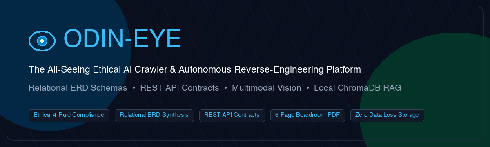

<p align="center">
  
</p>

<h1 align="center">👁️ Odin-Eye</h1>

<p align="center">
  <strong>The All-Seeing Ethical AI Crawler & Autonomous Full-Stack Reverse-Engineering Platform</strong>
</p>

<p align="center">
  <a href="https://github.com/nikhil-alakri/odin-eye"></a>
  <a href="https://github.com/nikhil-alakri/odin-eye/blob/main/LICENSE"></a>
  <a href="https://www.python.org/downloads/"></a>
  <a href="https://fastapi.tiangolo.com/"></a>
  <a href="https://integrate.api.nvidia.com/"></a>
  <a href="https://playwright.dev/"></a>
</p>

<p align="center">
  <a href="#-quick-tour--why-odin-eye">Quick Tour</a> •
  <a href="#-key-features">Key Features</a> •
  <a href="#-quick-start">Quick Start</a> •
  <a href="#-visual-blueprints--reverse-engineering">Visual Blueprints</a> •
  <a href="#-interactive-dashboard">UI Dashboard</a> •
  <a href="#-api-reference">REST API</a> •
  <a href="USAGE.md">Usage Guide</a> •
  <a href="FAQ.md">FAQ</a>
</p>

---

## ⚡ What is Odin-Eye?

In Norse myth, **Odin** sacrificed an eye for the cosmic ability to **see past all illusions**.

**Odin-Eye** brings that power to web engineering. It looks past the surface rendered UI of any modern web application and autonomously reconstructs what lies beneath:
- 🏛️ **Backend Database Architecture**: Inferred Relational Schemas (ERD) with tables, foreign keys, and constraints.
- 🔌 **REST API Contracts**: Inferred endpoints, query params, request bodies, and JSON responses.
- 🎨 **Authentic Design Systems**: Real dominant color palettes sampled directly from pixels (via PIL) and Atomic Design hierarchy (Organisms &rarr; Molecules &rarr; Atoms).
- 📊 **Boardroom-Ready Executive PDFs**: Publication-grade 6-page technical dossiers ready for CTOs and founders.
- 🛡️ **Guaranteed Ethical Crawling**: Built-in adherence to the 4 Ethical Crawling Rules (strict `robots.txt`, concurrency semaphores, polite delays, and transparent bot headers).
- 🧠 **Local Air-Gapped RAG**: Embedded ChromaDB vector memory for offline semantic search and citation-backed Q&A.

---

## 🌟 Architecture at a Glance

```
                                  [ Target Web App ]
                                          │
                  ┌───────────────────────┴───────────────────────┐
                  ▼                                               ▼
         [ Fast Async Engine ]                          [ Playwright Browser ]
           (httpx / 100ms)                            (JS SPAs / Screenshots)
                  │                                               │
                  └───────────────────────┬───────────────────────┘
                                          │
                                 [ Clean & Filter ]
                           (Stripped Ads, Modals, Navbars)
                                          │
                  ┌───────────────────────┼───────────────────────┐
                  ▼                       ▼                       ▼
          [ Pixel Palette ]       [ Domain Profiler ]       [ Vector Store ]
            (PIL Colorways)      (ERD & API Synthesis)      (Local ChromaDB)
                  │                       │                       │
                  └───────────────────────┼───────────────────────┘
                                          │
                                          ▼
                      [ Executive Boardroom PDF Report ]
                         (Exact 6-Page Vector Dossier)
```

---

## 🚀 Key Features

| Capability | Description | Time Saved |
|:---|:---|:---:|
| **🏛️ Autonomous Visual Reverse-Engineering** | Decomposes screenshots, detects domain archetypes (*Studio Production, E-Commerce, DevTools, SaaS*), and synthesizes ERDs, APIs, and Atomic wireframes. | **99%** *(10s vs 2 wks)* |
| **🛡️ 4 Rules of Ethical Crawling** | Automatic `robots.txt` discovery & TTL caching, politeness delays, HTTP 429 `Retry-After` backoff, and transparent User-Agent headers. | **Built-in Compliance** |
| **🔄 Scheduled Crawling & Diff Alerts** | Background cron jobs monitor target URLs, filter out dynamic DOM noise, and deliver instant Slack/Discord webhook alerts. | **100% Automated** |
| **🎯 Point-and-Click Selector Picker** | Interactive sandboxed iframe visual picker that isolates unique, resilient CSS selectors with live matching counts. | **95% Faster** |
| **🔍 Tech Stack Profiling** | Detects 40+ technologies across React, Next.js, Vue, Shopify, WordPress, Cloudflare, PostHog, and CDNs in under 1 second. | **Instant** |
| **🧠 Local ChromaDB RAG & History** | 1ms zero-network caching, semantic concept search, and natural language Q&A strictly grounded in crawled page context. | **Air-Gapped Privacy** |
| **📄 1-Click Multi-Format Export** | Stream any crawled page or entire crawl sets to **Boardroom PDF**, **Markdown**, **Plain Text**, **JSON**, or **CSV**. | **Instant Download** |

---

## ⚡ Quick Start

### 1. Installation

```bash
# 1. Clone repository
git clone https://github.com/nikhil-alakri/odin-eye.git
cd odin-eye

# 2. Setup virtual environment
python3 -m venv .venv
source .venv/bin/activate

# 3. Install core dependencies
pip install -e ".[dev]"

# 4. Install browser engine for dynamic JS apps & screenshots
pip install -e ".[browser]"
playwright install chromium
```

### 2. Configure Environment (`.env`)

```bash
cp .env.example .env
```

```env
# Bot Identification
CRAWLER_BOT_NAME=OdinEyeBot
CRAWLER_BOT_VERSION=1.0.0
CRAWLER_BOT_EMAIL=crawler@example.com
CRAWLER_BOT_URL=https://github.com/nikhil-alakri/odin-eye

# Ethical Crawling & Politeness
CRAWLER_DEFAULT_DELAY=2.0
CRAWLER_MAX_CONCURRENCY=5
CRAWLER_RESPECT_ROBOTS_TXT=true

# Optional: NVIDIA NIM / OpenAI API
CRAWLER_AI_BASE_URL=https://integrate.api.nvidia.com/v1
CRAWLER_AI_API_KEY=your_key_here
CRAWLER_AI_MODEL=meta/llama-3.3-70b-instruct
```

---

## 💻 CLI Commands

Run using `./crawler` or `python -m ethical_crawler.cli`:

### 1. Scrape & Instant Boardroom PDF Export
```bash
# Scrape single page with instant terminal summary
crawler scrape https://example.com

# Scrape and stream directly into a styled PDF document
crawler scrape https://example.com --output report.pdf --format pdf

# Scrape into clean GitHub-Flavored Markdown
crawler scrape https://example.com --output article.md
```

### 2. Crawl Entire Websites Ethically
```bash
# Ethical crawl honoring robots.txt and sitemap
crawler crawl https://example.com --max-pages 10 --output results.json

# Headless browser crawl for client-side JavaScript SPAs
crawler crawl https://spa-example.com --strategy browser --output results.md
```

### 3. Verify Robots.txt Directives (Rule 1)
```bash
# Inspect allowed/disallowed rules and crawl-delay
crawler robots https://example.com

# Check permission for a specific path
crawler robots https://example.com --check /admin/billing
```

### 4. Local Vector Search & Offline RAG Q&A
```bash
# Search crawled knowledge by semantic concept
crawler search "pricing tiers and seat limits"

# Ask an AI question answered strictly from your crawled pages
crawler ask "What are the key differences between the Free and Pro tiers?"

# View local ChromaDB crawl history
crawler history
```

---

## 🖥️ Interactive Web Dashboard

Launch the visual interface:

```bash
crawler serve --host 0.0.0.0 --port 8000
```

Open **`http://localhost:8000`** in your browser:

- 🧭 **Crawler & Scraper Studio**: Launch jobs, inspect live real-time progress, and preview captured DOM structures.
- 🏛️ **Visual Blueprint Generator**: Generate full architectural dossiers from screenshots and export 6-page boardroom PDFs.
- 🎯 **Point-and-Click Selector Picker**: Sandboxed interactive visual element selector.
- 🔄 **Scheduled Crawl Manager**: Configure recurring cron schedules and webhook alerts.
- 🧠 **Knowledge Store & RAG Chat**: Chat with crawled documentation offline with source citations.
- 🎨 **Design System Studio**: Switch between Obsidian Dark, Editorial Light, and Custom Color themes.
- 📚 **Swagger API Docs**: Explore interactive REST endpoints at `http://localhost:8000/docs`.

---

## 🌐 REST API Reference

| Method | Endpoint | Description |
|:---|:---|:---|
| `POST` | `/api/v1/scrape` | Immediate single-page scrape with optional AI extraction |
| `GET/POST`| `/api/v1/scrape/export` | Scrape URL and stream back as `.pdf`, `.md`, `.txt`, `.json`, or `.csv` |
| `POST` | `/api/v1/crawl` | Start asynchronous crawl job (returns `job_id`) |
| `GET` | `/api/v1/jobs/{job_id}` | Check status, progress, and results of a crawl job |
| `GET` | `/api/v1/blueprints/domains` | List domains with captured screenshots available for blueprinting |
| `POST` | `/api/v1/blueprints/generate` | Synthesize ERD schema, APIs, and wireframes from screenshots |
| `GET` | `/api/v1/blueprints/export/pdf` | Export boardroom-grade 6-page executive PDF blueprint |
| `POST` | `/api/v1/schedules` | Create recurring cron crawl schedule with diff monitoring & webhooks |
| `GET` | `/api/v1/schedules` | List active crawl schedules and historical change alerts |
| `GET` | `/api/v1/element-picker/sandbox`| Interactive sandboxed visual CSS selector picker |
| `POST` | `/api/v1/tech-profile` | Scan target website for frameworks, CMS, analytics & infrastructure |
| `GET` | `/api/v1/search` | Semantic vector search across all stored web pages (`?q=...`) |
| `POST` | `/api/v1/ask` | Local RAG Q&A answering strictly from crawled context |

---

## 🧪 Running the Test Suite

All 23+ unit, scenario, and API tests run fully offline without live external network dependencies:

```bash
PYTHONPATH=src python3 -m pytest tests/ -v
```

---

## 📖 Deep-Dive Documentation

- **[USAGE GUIDE (Why, When, Where, How, Time Savings)](USAGE.md)**: Deep architectural guide, comparison tables, and full walkthroughs.
- **[FREQUENTLY ASKED QUESTIONS (FAQ)](FAQ.md)**: Answers on ethics, vision models, diff false-alarm filtering, and compliance.
- **[Architecture Specifications](Raw/features/)**: Complete internal design documents and implementation records.

---

## 🛡️ License & Community

Distributed under the **MIT License**. Free and open-source for personal and commercial use. See [`LICENSE`](LICENSE) for details.

<p align="center">
  <strong>Built with precision for ethical web engineering. If Odin-Eye helps your workflow, please consider giving it a ⭐ on GitHub!</strong>
</p>
