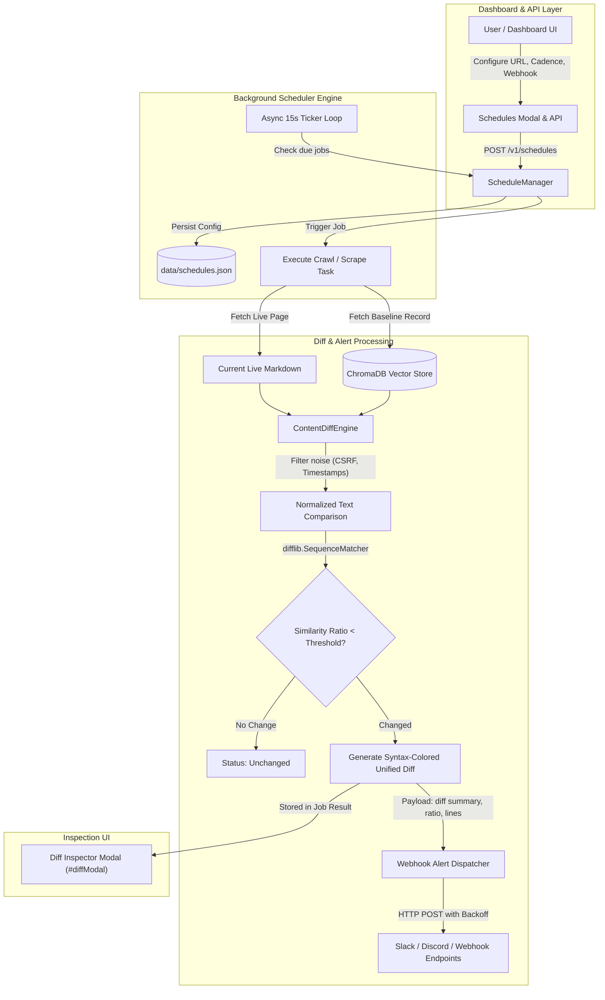
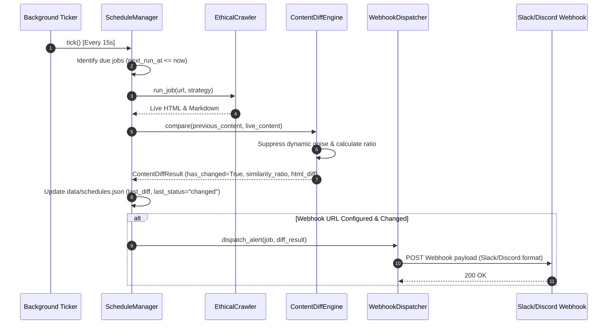
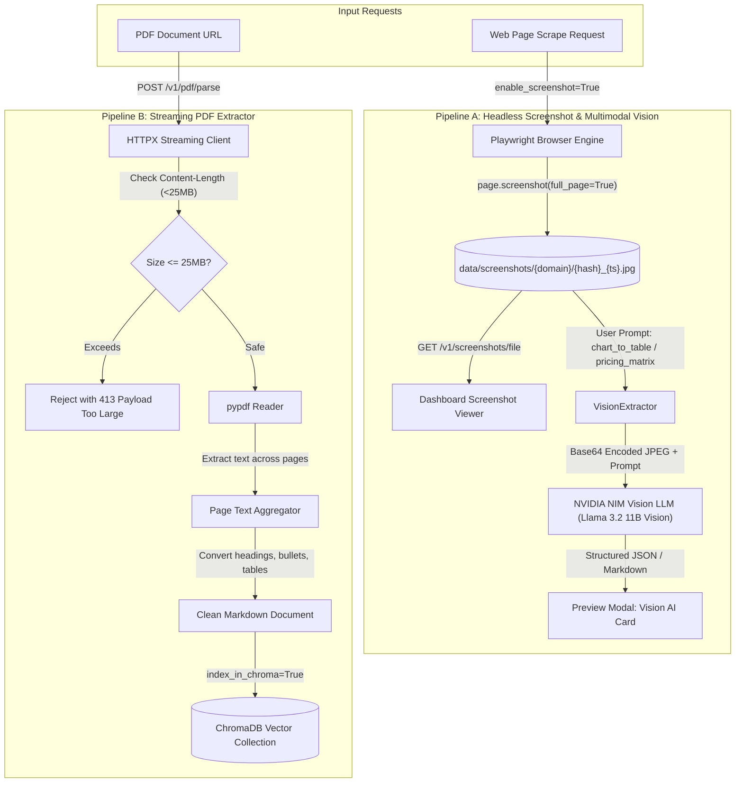
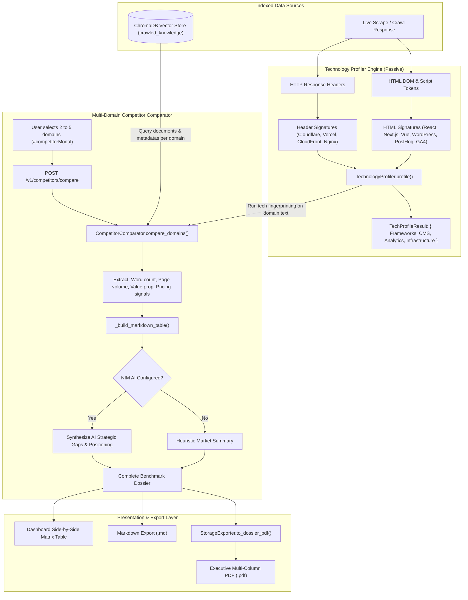

# Architecture & Workflow Diagrams: Autonomous Features Suite
**Date & Time**: 09-Oct-2026 14:25

This document details the architectural workflows, data flows, and component interactions for all 4 features:
1. **Feature 1**: Scheduled Crawling, Content Diff & Change Alerts
2. **Feature 2**: Vision & Multimodal Extraction (Screenshots, Vision LLM, PDF Ingestion)
3. **Feature 3**: Interactive Point-and-Click Visual Element Picker
4. **Feature 5**: Competitive Intelligence & Technology Stack Profiling

---

## 1. Feature 1: Scheduled Crawling, Content Diff & Change Alerts

### System Flowchart


### Sequence Diagram: Scheduled Change Detection Cycle


---

## 2. Feature 2: Vision & Multimodal Extraction (Screenshots, Vision LLM, PDF Ingestion)

### Dual-Pipeline Flowchart


---

## 3. Feature 3: Interactive Point-and-Click Visual Element Picker

### Sandboxed DOM Architecture
```mermaid
flowchart TD
    subgraph Frontend["Dashboard UI"]
        ScraperForm["Scraper Form / RPA Builder"] -->|"Click 'Pick Element'"| PickerModal["Element Picker Modal (#elementPickerModal)"]
        PickerModal -->|"Set iframe src"| IframeSand["Sandboxed <iframe> (allow-scripts allow-same-origin)"]
    end

    subgraph API["FastAPI Sandbox Service"]
        IframeSand -->|"GET /v1/elements/sandbox?url=..."| SandboxEndpoint["get_element_picker_sandbox()"]
        SandboxEndpoint -->|"Fetch target webpage"| TargetWeb["Target Web Server"]
        TargetWeb -->>SandboxEndpoint["Raw HTML Response"]
        
        SandboxEndpoint --> Sanitize["ElementPicker.sanitize_and_prepare_html()"]
        
        subgraph Instrument["Instrumentation & Hardening Engine"]
            Sanitize --> Breakout["Neutralize window.top / parent.location breakouts"]
            Breakout --> BaseTag["Inject <base href='url'> for CSS & fonts"]
            BaseTag --> InjectJS["Inject Client Script: __ethic_element_picker_script__"]
        end
        
        InjectJS -->>IframeSand["Instrumented HTML (X-Frame-Options: SAMEORIGIN)"]
    end

    subgraph DOMInteraction["In-Iframe User Interaction"]
        UserMove["User hovers mouse"] --> Highlight["Outline element & show floating tag badge"]
        UserClick["User clicks element"] --> Intercept["e.preventDefault() & e.stopPropagation()"]
        Intercept --> GenerateSelector["Synthesize optimal CSS selector (#id, [data-*], .class)"]
        GenerateSelector --> PostMsg["window.parent.postMessage(ELEMENT_PICKED)"]
    end

    subgraph Feedback["Selector Population"]
        PostMsg --> Listener["Parent Window Message Listener"]
        Listener --> Toolbar["Update Selector Input, Tag Badge, Match Count"]
        Toolbar -->|"Click 'Use Selector'"| Apply["Auto-populate scrapeUrl / rpaStepSelector"]
    end
```

---

## 4. Feature 5: Competitive Intelligence & Technology Stack Profiling

### Cross-Domain Intelligence Architecture


