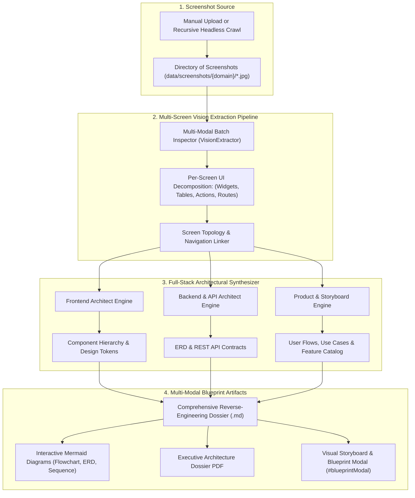

# Specification: Visual Product Blueprint & Reverse-Engineering Engine
**Date & Time**: 11-Oct-2026 01:35

---

## 1. Executive Summary & Objective
Modern web applications—particularly gated SaaS products, dashboards, and internal admin portals—encode an immense amount of product logic, system design, and commercial intelligence strictly within their visual interfaces. Traditional text scrapers fail completely on visual-heavy dashboards because graphs, tables, and workflows are rendered dynamically or hidden behind authentication.

The **Visual Product Blueprint & Reverse-Engineering Engine** takes a collection of multi-page screenshots from any application (e.g. landing page, login, dashboard, analytics, user management, billing, settings) and automatically produces a complete, production-grade **Full-Stack Product Specification & Architectural Blueprint**:
1. **Visual Storyboard & Navigation Linking**: Maps the screen-to-screen topology and state transitions into an interactive user journey flow.
2. **Product Strategy & Feature Inventory**: Complete breakdown of value proposition, target personas, use cases, and categorized feature matrices.
3. **Frontend Architectural Thinking**: Deconstructed component tree (layouts, widgets, modals), design tokens (colors, typography scales, spacing), and responsive UI guidance.
4. **Backend Architectural Thinking & API Contracts**: Inferred REST/GraphQL endpoints, request/response JSON schemas, database entity-relationship models (ERD), and business logic rules.
5. **Rich Mermaid Diagrams**: In-depth flowcharts, sitemaps, sequence diagrams, and ER diagrams synthesizing the entire application.

---

## 2. Skill Alignment & Methodology (`.agents/skills`)

| Specialized Skill | Role & Responsibility in the Engine |
| :--- | :--- |
| **`engineering-software-architect`** | - Inferred System Architecture: Microservice topology, data storage layers, auth mechanisms. - Architectural decision records (ADRs) explaining technical trade-offs implied by the UI. |
| **`engineering-backend-architect`** | - Inferred Database Schema: Synthesizes Entity-Relationship Diagrams (ERD) from visual tables, filters, and form inputs. - API Contract Synthesis: Produces OpenAPI/REST endpoint specifications (headers, path, query, payload bodies, error states). |
| **`engineering-frontend-developer`** | - Component Hierarchy Decomposition: Atomic breakdown (Atoms, Molecules, Organisms, Templates, Pages). - State Management Mapping: Form states, optimistic UI updates, client vs. server component boundaries. |
| **`design-ui-designer`** | - Visual Design System Extraction: Color palette hex codes, font hierarchy, visual weight, spacing grid, accessible contrast audits. - UI critique and usability enhancement recommendations. |
| **`product-manager`** | - User Journey & Storyboard: Chronological workflow tracing from entry to task completion. - Feature Matrix & User Stories: Formatted user stories with acceptance criteria (Gherkin syntax). |
| **`engineering-ai-engineer`** | - Multi-Screen Vision Context Chaining: Feeds ordered screenshot batches to NVIDIA NIM Vision models with specialized structured extraction prompts. |

---

## 3. High-Level Architecture & Data Flow

---

## 4. In-Depth Blueprint Sections Generated

Every generated Product Blueprint will contain the following structured sections:

### Section 1: Executive Product Overview & Storyboard
* **Product Purpose & Core Value Proposition**: What problem this application solves and for whom.
* **Target Personas & Permissions**: Role-based breakdown (e.g. Superadmin, Org Manager, Analyst, Viewer).
* **Interactive Storyboard**: Step-by-step walkthrough illustrating the primary end-to-end user journeys with referenced screenshot anchors.
* **Mermaid User Flow Diagram**: `sequenceDiagram` or `stateDiagram-v2` showing transitions between screens.

### Section 2: Complete Feature Inventory & Use Case Catalog
* **Feature Catalog**: Grouped into Core Modules (e.g. Authentication, Analytics Dashboard, Content Management, Team & Roles, Billing & Subscriptions, Security & Audit Logs).
* **Detailed Use Cases**:
  * *Actor*: Who triggers it
  * *Preconditions*: Required permissions or prior screen state
  * *Trigger & Input*: Specific form inputs or button clicks
  * *Expected Outcome*: Mutated data, feedback toast, or subsequent route.

### Section 3: Frontend Architecture & UI Design Guidance
* **Component Tree Breakdown**:
  * *Layout Components*: `AppShell`, `SidebarNav`, `HeaderToolbar`, `NotificationDrawer`.
  * *Page Views*: Modular breakdown of each unique route.
  * *Reusable Widgets*: `MetricCard`, `TimeSeriesChart`, `FilterBar`, `PaginatedDataTable`, `ConfirmModal`.
* **Design System & Visual Tokens**:
  * Extracted primary, secondary, surface, background, and alert colors.
  * Typography hierarchy (headings, body, monospace data cells).
  * Spacing, border-radii, and elevation shadows.
* **UX Critique & Polish Recommendations**: Actionable usability, accessibility (a11y), and interaction improvements.

### Section 4: Backend Thinking, Inferred Data Models & API Contracts
* **Inferred Database Schema (ERD)**:
  * Full Mermaid `erDiagram` showing tables, primary/foreign keys, and relational cardinality (e.g., `ORGANIZATION ||--o{ USER`, `USER ||--o{ TRANSACTION`).
  * Field types, constraints, and audit timestamps.
* **Inferred REST / GraphQL API Specifications**:
  * Endpoints inferred directly from page actions and tables (e.g. `GET /api/v1/analytics/overview`, `POST /api/v1/users/invite`, `PATCH /api/v1/settings/organization`).
  * Query parameters (pagination, sorting, date ranges).
  * Request and response JSON schema models with realistic mock data.

---

## 5. UI Integration in Ethical Crawler Dashboard
* **Visual Gallery & Storyboard Modal (`#blueprintModal`)**:
  * Domain selector with screenshot counter (e.g. `12 screens captured`).
  * Thumbnail carousel of all screenshots with automatic route tagging.
  * Single-click **"Generate Product Blueprint & Architecture"** action.
  * Tabbed viewer:
    1. 📋 **Executive Blueprint & Storyboard**
    2. 📊 **Mermaid Architectural Diagrams**
    3. 💻 **Frontend & Design System**
    4. ⚙️ **Backend Models & API Contracts**
  * 1-Click Exports: Download as Markdown or ReportLab Multi-Column PDF.

