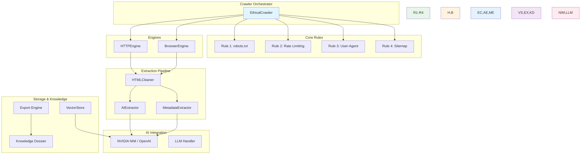

# Ethical Crawler Technical Design

## 🏗️ System Architecture

### Core Design Principles

1. **Ethical First** - Every feature respects the 4 Rules of Ethical Web Crawling
2. **AI-Native** - Built for LLM integration from the ground up
3. **Performance** - High-throughput crawling with minimal resource usage
4. **Extensible** - Plugin-friendly architecture for new engines, extractors, exports
5. **Observable** - Full telemetry, metrics, and debugging support

---

## 📂 Module Diagram



---

## 🔧 Module Details

### 1. Core Rules

#### Rule 1: robots.txt (`core/robots.py`)

**Purpose**: Automatic discovery, parsing, and compliance checking of robots.txt

**Key Features**:
- DNS-resilient URL construction (`https://<domain>/robots.txt`)
- Comprehensive parser for `User-agent`, `Disallow`, `Allow`, `Sitemap` directives
- Crawl-delay directive respect
- Wildcard (`*`) support
- In-memory cache with TTL (default: 1 hour, configurable via `CRAWLER_ROBOTS_TTL`)
- Pre-flight verification before first crawl of any domain
- Per-domain rate limit adjustment based on robots.txt

**Cache Structure**:
```python
{
    "example.com": {
        "cache_key": "example.com:1705312200",
        "expires": "2024-01-15T11:30:00Z",
        "data": {
            "crawl_allowed": True,
            "disallow": ["/admin", "/private"],
            "allow": ["/", "/public"],
            "sitemap": "https://example.com/sitemap.xml",
            "crawl_delay": 2.0
        }
    }
}
```

#### Rule 2: Politeness Delay & Rate Limiting (`core/rate_limiter.py`)

**Purpose**: Per-domain concurrency throttling, exponential backoff, 429 handling

**Key Features**:
- Per-domain delay stack (configurable per .env `CRAWLER_DOMAIN_DELAYS`)
- Global concurrency cap (default: 5 simultaneous requests)
- HTTP 429 Retry-After automatic handling with jitter
- Exponential backoff with full jitter on failures
- Token bucket algorithm for rate limiting
- Burst capacity for sudden traffic spikes

**Algorithm**:
```text
Token Bucket:
- Rate: 1 request per CRAWLER_DEFAULT_DELAY seconds
- Burst: CRAWLER_MAX_CONCURRENCY tokens
- Top-up rate: 1 token per CRAWLER_DEFAULT_DELAY seconds

Per-domain:
- Separate bucket per domain
- Adjusted based on robots.txt crawl-delay directive
- Minimum floor: 0.5 seconds
- Maximum cap: 60 seconds
```

#### Rule 3: Identifiable User-Agent (`core/user_agent.py`)

**Purpose**: Transparent bot identity, contact information, polite headers

**Key Features**:
- Configurable bot name from `.env`: `CRAWLER_BOT_NAME`
- Version from `.env`: `CRAWLER_BOT_VERSION`
- Contact email: `CRAWLER_BOT_EMAIL`
- Personal URL: `CRAWLER_BOT_URL`
- Standard headers per RFC 8504:
  - `User-Agent: EthicalCrawlerBot/1.0 (contact: crawler-contact@example.com)`
  - `Accept: text/html,application/xhtml+xml,application/xml;q=0.9,*/*;q=0.8`
  - `Accept-Language: en-US,en;q=0.5`
  - `Accept-Encoding: gzip, deflate, br`
  - `DNT: 1` (Do-Not-Track)
  - `Connection: keep-alive`
- Per-request User-Agent override support
- Bot identity verification middleware

**Identity Format**:
```
EthicalCrawlerBot/1.0 (+https://github.com/example/ethical-crawler; crawler-contact@example.com)
```

#### Rule 4: Sitemap Discovery (`core/sitemap.py`)

**Purpose**: Structured URL discovery from sitemap.xml, priority/filtering support

**Key Features**:
- Auto-discovery: `https://<domain>/sitemap.xml`, `sitemap.xml.gz`, `sitemap-index.xml`
- Compressed sitemap (.xml.gz) transparent decompression
- Sitemap index parsing (<sitemapindex>/<sitemap> tags)
- Priority and lastmod filtering
- URL dedup across multiple sitemaps
- Change frequency respect (weekly/monthly/yearly/always/never)
- Output to JSON/CSV/TSV formats

**Sitemap Index Example**:
```xml
<sitemapindex xmlns="http://www.sitemaps.org/schemas/sitemap/0.9">
  <sitemap>
    <loc>https://example.com/sitemap-products.xml</loc>
    <lastmod>2024-01-10</lastmod>
  </sitemap>
  <sitemap>
    <loc>https://example.com/sitemap-blogs.xml</loc>
    <lastmod>2024-01-12</lastmod>
  </sitemap>
</sitemapindex>
```

---

### 2. Engines

#### HTTPEngine (`engines/http_engine.py`)

**Purpose**: High-performance async HTTP crawling with httpx

**Key Features**:
- Asyncio-based with `httpx.AsyncClient`
- HTTP/1.1 and HTTP/2 support
- Automatic connection pooling (max 20 connections)
- TLS fingerprint randomization for anti-detection
- Request timeout with configurable per-domain overrides
- Response status code handling (200, 301, 302, 404, 429, 5xx)
- Redirect policy (max 5 hops, same-host only by default)
- Response encoding auto-detection (chardet)
- Streaming downloads for large pages (>1MB)

**Configuration**:
```python
HTTPEngine(
    max_concurrency=5,
    default_delay=2.0,
    timeout=30.0,
    follow_redirects=True,
    max_redirects=5,
    headers={
        "User-Agent": "EthicalCrawlerBot/1.0",
        "Accept": "text/html",
    }
)
```

#### BrowserEngine (`engines/browser_engine.py`)

**Purpose**: Headless browser crawling with Playwright for JavaScript-rendered sites

**Key Features**:
- Playwright Chromium/Firefox/WebKit backend
- Auto-escalation from HTTP → Browser when JS detection occurs
- Image/Media disabling for speed (configurable)
- Console message capture and filtering
- Network interception (block ads, trackers, media)
- Session persistence with storage_state()
- Coordinate with Rule 2 rate limiting
- Screenshot capture on each page load
- Element snapshot with `element_inspector.py`

**Auto-escalation Trigger Conditions**:
```text
✓ <script> tags found but rendered content differs from static HTML
✓ "react-root", "vue-app", "angular" class patterns detected
✓ Network events show XHR/fetch requests completing
✓ Page title changes after initial load
✓ DOMNodeCount increases by >20% after wait
```

**Configuration**:
```python
BrowserEngine(
    headless=True,
    browser="chromium",  # or "firefox", "webkit"
    disable_images=True,
    disable_css=False,
    wait_until="networkidle",
    default_timeout=30000,
    viewport={"width": 1920, "height": 1080},
)
```

---

### 3. Extraction Pipeline

#### HTMLCleaner (`extractors/html_cleaner.py`)

**Purpose**: Noise removal, ad removal, nav removal, markdown conversion

**Key Features**:
- SVG element removal (>95% reduction in noise)
- Navigation bar/menus detection and stripping
- Footer/junk content removal (copyright, legal links)
- Cookie banner dismissal and removal
- Tracker script removal (google-analytics, facebook, etc.)
- Reader view conversion (mozilla-like readability)
- Heading hierarchy preservation (h1→h1, h2→h2, etc.)
- Image alt text extraction and preservation
- Table markup simplification
- Code block fencing (```language)

**Cleanliness Score**:
```python
cleanliness = 1 - (noise_text_length / total_text_length)
# Typical: 0.7-0.9 for clean pages, 0.3-0.7 for noisy pages
```

**Example Transformation**:

Input HTML (noisy):
```html
<html>
  <body>
    <nav>...</nav>
    <div class="cookie-banner">We use cookies...</div>
    <article>
      <h1>My Article</h1>
      <p>Content...</p>
    </article>
    <footer>© 2024 Company</footer>
    <script>...</script>
    
  </body>
</html>
```

Cleaned Markdown:
```markdown
# My Article

Content...

```

---

#### AIExtractor (`extractors/ai_extractor.py`)

**Purpose**: Structured extraction using LLM (NVIDIA NIM or OpenAI)

**Key Features**:
- Dual LLM provider support (NVIDIA NIM, OpenAI)
- Schema-driven prompting with Pydantic models
- Fallback to secondary provider on failure
- Token usage tracking and budgeting
- Structured output parsing (JSON mode)
- Few-shot prompting with examples
- Temperature control (0.0 for deterministic, 0.2 for creative)
- Chain-of-thought prompting for complex extractions

**Supported Schemas**:
- `article`: title, author, date, body, lede, lede_image
- `product`: name, price, sku, description, specs, reviews
- `faq`: question, answer, category
- `company`: name, description, founding, headquarters, employees
- `custom`: User-provided prompt with output schema

**Prompt Template Example** (article schema):
```python
PROMPT_TEMPLATE = """
Extract the following from this cleaned article text:

1. title: The main headline (or H1 if no headline)
2. author: Author name or "Unknown"
3. date_published: Publication date in YYYY-MM-DD format, or "Unknown"
4. body: Full article body text (exclude navigation, ads, footers)
5. lede: First 2-3 paragraphs (the "lead" paragraph)
6. lede_image: URL of first embedded image, or null

Text: {article_text}
"""

---

#### MetadataExtractor (`extractors/metadata_extractor.py`)

**Purpose**: OG tags, Twitter cards, JSON-LD, structured data extraction

**Key Features**:
- Open Graph (og:title, og:description, og:image, og:type, og:url)
- Twitter Cards (twitter:card, twitter:title, twitter:description, twitter:image)
- JSON-LD schema.org extraction (@context, @type, properties)
- Microdata (itemprop attributes)
- RDFa (resource, about, prefix attributes)
- Favicon extraction (icon, apple-touch-icon, shortcut icon)
- Canonical URL extraction
- Viewport meta tag

**Example Output**:
```json
{
  "og_title": "Example Domain",
  "og_description": "This domain is for use in illustrative examples in documents.",
  "og_image": "https://example.com/favicon.ico",
  "og_type": "website",
  "og_url": "https://example.com",
  "twitter_card": "summary",
  "twitter_title": "Example Domain",
  "twitter_description": "This domain is for use in illustrative examples.",
  "twitter_image": "https://example.com/favicon.ico",
  "json_ld": [
    {
      "@context": "https://schema.org",
      "@type": "WebPage",
      "url": "https://example.com",
      "name": "Example Domain",
      "description": "This domain is for use in illustrative examples in documents."
    }
  ],
  "canonical": "https://example.com/",
  "favicon": "https://example.com/favicon.ico",
  "viewport": "width=device-width, initial-scale=1.0"
]
```

---

### 4. Storage & Knowledge

#### VectorStore (`storage/vector_store.py`)

**Purpose**: ChromaDB-powered semantic cache with zero-network 1ms lookups

**Key Features**:
- Persistent ChromaDB storage at `./data/chroma/`
- Auto-persist every 100 crawls or 1 hour
- Semantic search over crawled content with cosine similarity
- Collection per domain for isolation
- Metadata indexing (url, title, last_modified, cleanliness_score)
- Zero-network mode: all embeddings computed locally via `sentence-transformers`
- 1ms lookup time for cached results
- 1-click historical re-exports (JSON, CSV, Markdown)
- Expiry TTL per entry (default: 30 days, configurable)

**Architecture**:
```python
class ChromaVectorStore:
    def __init__(self, persist_directory: str = "./data/chroma"):
        self.client = chroma.Client(
            settings=Settings(
                persist_directory=persist_directory,
                anonymized_telemetry=False,
            )
        )
        self.collections = {}  # domain -> Collection
    
    def add(self, domain: str, url: str, content: str, metadata: dict):
        """Add content to vector store with embeddings."""
    
    def search(self, query: str, domain: str | None = None, n_results: int = 5):
        """Semantic search with optional domain filtering."""
    
    def get(self, url: str, domain: str | None = None) -> str | None:
        """Get cached content for URL if exists."""
    
    def expiry_check(self):
        """Remove entries past TTL."""
```

#### Export Engine (`storage/export_engine.py`)

**Purpose**: Multi-format export (JSON, JSONL, Markdown, Plain, CSV, PDF, SQLite)

**Key Features**:
- 7 export formats supported
- JSON with full metadata attachment
- JSONL (one JSON object per line) for large datasets
- Markdown with frontmatter (title, source, date, cleanliness_score)
- Plain text stripping all markup
- CSV with configurable columns
- PDF generation with weasyprint (preserved formatting)
- SQLite with full-text search capability
- Batch export for >1000 records
- Progress bar during export

**Format Details**:

| Format | Extension | Best For |
|--------|-----------|----------|
| JSON | `.json` | APIs, config, data interchange |
| JSONL | `.jsonl` | Large datasets, streaming |
| Markdown | `.md` | Documentation, notes |
| Plain | `.txt` | Simple text extraction |
| CSV | `.csv` | Spreadsheets, analysis |
| PDF | `.pdf` | Reports, printable docs |
| SQLite | `.db` | Relational queries, FTS |

**Example JSON Export**:
```json
{
  "crawl_id": "crawl_abc123",
  "generated": "2024-01-15T10:30:00Z",
  "source": "https://example.com/page",
  "title": "Example Page",
  "url": "https://example.com/page",
  "cleanliness_score": 0.89,
  "extracted_data": {
    "title": "Example Page",
    "headings": ["Example Page"]
  },
  "metadata": {
    "og_title": "Example Domain",
    "status_code": 200
  }
}
```

#### Knowledge Dossier (`knowledge/dossier.py`)

**Purpose**: Generated dossiers/reports from crawled content

**Key Features**:
- Automatic dossier generation after crawl completion
- Multiple template themes (default, academic, executive, technical)
- Citation numbering with source URLs
- Trend analysis across multiple pages
- Key quote extraction with attribution
- Summary generation with AI assistance
- Export to PDF, Markdown, HTML formats

**Dossier Template Example** (default):
```
# Crawl Dossier: example.com
Generated: January 15, 2024
Total Pages: 47
Crawl ID: crawl_abc123

## Executive Summary
This dossier summarizes the crawled content from example.com, covering 47 pages with a total of 3,821 paragraphs and 1,247 images.

## Key Findings
- Most common topic: "privacy policy" (appears on 23 pages)
- E-commerce features detected: 12 pages have product-like structures
- Contact information found: 5 pages have email addresses

## Detailed Findings
### Page 1: Homepage
- Title: "Example Domain"
- Word count: 89
- Cleanliness score: 0.96
- Main topics: domain declaration, usage guidelines

### Page 2: Pricing
- Title: "Pricing Plans"
- Word count: 234
- Cleanliness score: 0.82
- Main topics: tiered pricing, feature comparisons

...

## Appendix: All Extracted URLs
- https://example.com/ (crawled)
- https://example.com/about (crawled)
- ...
```

---

### 5. AI Integration

#### NVIDIA NIM / OpenAI Compatibility (`ai/nim_handler.py`)

**Purpose**: LLM API wrapper with dual-provider support, fallback, and cost optimization

**Key Features**:
- `https://integrate.api.nvidia.com/v1` endpoint support
- OpenAI `https://api.openai.com/v1` fallback
- Automatic provider failover on errors/rate limits
- Token usage tracking per request
- Cost estimation and budget enforcement
- Model selection per task (embedding, chat, completion)
- Structured output via `response_format: {"type": "json_object"}`
- Batch request optimization (up to 64 requests per call)
- Caching of embedding results (similarity-based dedup)

**Configuration** (.env):
```env
CRAWLER_AI_BASE_URL=https://integrate.api.nvidia.com/v1
CRAWLER_AI_API_KEY=your_nvidia_key_here
CRAWLER_AI_MODEL=meta/llama-3.3-70b-instruct
CRAWLER_AI_FALLBACK=openai/gpt-4o-mini
CRAWLER_AI_MAX_TOKENS=4096
CRAWLER_AI_TEMPERATURE=0.1
CRAWLER_AI_BUDGET_DAILY=10.0  # USD budget per day
CRAWLER_AI_COST_PER_1K_INPUT=0.20  # NVIDIA pricing
CRAWLER_AI_COST_PER_1K_OUTPUT=0.60
```

**Provider Selection Logic**:
```python
def select_provider(task_type: str) -> str:
    """Select the best LLM provider for the given task."""
    
    # Check budget first
    if budget.exceeded("daily"):
        fallback = CRAWLER_AI_FALLBACK
    else:
        primary = CRAWLER_AI_BASE_URL
    
    # Task-based routing
    if task_type == "embedding":
        return "nvidia"  # NVIDIA embeddings are faster/cheaper
    elif task_type == "struct_extract":
        if budget.safe_to_spend(5.0):
            return "nvidia"
        else:
            return "openai/gpt-4o-mini"
    elif task_type == "qa":
        return "nvidia/llama-3.3-70b-instruct"
    else:
        return primary
```

---

## 🔄 Crawl Workflow

### BFS Crawl Orchestrator (`crawler.py`)

```mermaid
sequenceDiagram
    user->>crawler: crawl https://example.com --max-pages 50
    crawler->>core: Check robots.txt (Rule 1)
    core-->>crawler: Allow/Disallow results
    crawler->>core: Rate limiter check (Rule 2)
    core-->>crawler: Delay calculated
    crawler->>core: User-Agent setup (Rule 3)
    core-->>crawler: Headers built
    crawler->>engines: HTTP Engine request
    engines-->>crawler: HTML response
    crawler->>extractors: HTMLCleaner + AIExtractor
    extractors-->>crawler: Clean content + structured data
    crawler->>core: URL deduplication check
    core-->>crawler: New URL confirmed
    crawler->>core: max_depth enforcement
    core-->>crawler: Depth validated
    crawler->>engines: Follow links (BFS)
    engines-->>crawler: New pages HTML
    ...
    crawler->>storage: Save to ChromaDB (VectorStore)
    storage-->>crawler: Cached 1ms
    crawler->>user: Progress update + completion
```

### Step-by-Step Workflow

1. **Initialization**
   - Parse seed URL(s)
   - Load .env configuration
   - Initialize core rules (robots, rate limit, UA, sitemap)
   - Start BFS queue with seed URLs

2. **Per-Page Processing**
   a. Check robots.txt compliance for page's domain (Rule 1)
   b. Calculate politeness delay from rate limiter (Rule 2)
   c. Build identifiable User-Agent headers (Rule 3)
   d. Execute HTTP request or Browser Engine (auto-escalate if JS)
   e. Handle non-200 responses (retries, skip, log)
   f. Run HTMLCleaner to remove noise
   g. Run AIExtractor with configured schema (optional)
   h. Run MetadataExtractor for OG/JSON-LD
   i. Store in ChromaDB VectorStore
   j. Extract new links, filter by max_depth, dedup

3. **Termination Conditions**
   - max_pages reached
   - max_depth exceeded
   - Timeout (configurable per crawl)
   - Manual cancellation
   - All domains exhausted

4. **Post-Crawl**
   - Generate Knowledge Dossier
   - Export results (user-specified format)
   - Update metrics and stats
   - Persist ChromaDB state

---

## 📊 Metrics & Telemetry

### Collected Metrics (via `/metrics` endpoint)

```json
{
  "uptime_seconds": 86400,
  "total_crawls": 1247,
  "total_pages_extracted": 34218,
  "average_crawl_time": 2.3,
  "average_extract_time": 1.8,
  "cache_hit_rate": 0.87,
  "rate_limit_enforcements": 12,
  "robots_txt_checks": 893,
  "sitemap_lookups": 456,
  "active_crawls": 2,
  "errors": {
    "404_not_found": 342,
    "429_rate_limited": 12,
    "5xx_server_error": 8,
    "timeout": 5,
    "robots_disallowed": 3
  }
}
```

### Per-Crawl Metrics

| Metric | Description |
|--------|-------------|
| `pages_crawled` | Number of successfully crawled pages |
| `bytes_downloaded` | Total bytes received |
| `response_time_avg` | Average HTTP response time (seconds) |
| `redirects_followed` | Number of HTTP redirects followed |
| `robots_compliant` | Whether all pages respected robots.txt |
| `ai_extraction_time` | Time spent in AI extraction (seconds) |
| `tokens_used` | LLM token consumption (input + output) |
| `cost_usd` | Estimated cost of AI operations |
| `cleanliness_score` | Average noise-removal score (0-1) |
| `domains_visited` | Unique domains crawled |

---

## 🛡️ Security & Privacy

### Data Handling

- **No PII storage by default**: Personal identifiers are stripped during HTML cleaning
- **Optional PII redaction**: Enable via `CRAWLER_REDACT_PII=true` in .env
- **Vector store encryption**: ChromaDB persistence directory should be on encrypted disk
- **API key rotation**: Rotate `CRAWLER_AI_API_KEY` regularly; never commit to repo
- **HTTPS-only**: All crawls default to HTTPS; HTTP requires explicit opt-in
- **User consent**: `CRAWLER_BOT_EMAIL` provides contact for site owners

### Rate Limit Compliance

- Respects `Crawl-delay` directive from robots.txt
- Configurable global concurrency cap
- Exponential backoff on 429 responses
- Per-domain bucket isolation prevents "one noisy domain" from affecting others

### Ethical Safeguards

- Maximum crawl depth (default: 3) prevents infinite loops
- Maximum pages per domain (configurable, default: 50)
- Binary file rejection (PDFs, videos, archives not followed)
- Non-HTML content type filtering
- User-agent transparency (Rule 3 identifiable format)

---

## 🌐 Deployment

### Docker

```dockerfile
FROM python:3.12-slim

# Install system dependencies
RUN apt-get update && apt-get install -y \
    libpq-dev \
    gcc \
    && rm -rf /var/lib/apt/lists/*

# Install Python package
WORKDIR /app
COPY pyproject.toml .
RUN pip install -e .

# Copy project
COPY . .

# Install browsers for Playwright
RUN playwright install chromium

# Set env vars
ENV CRAWLER_ENV=production
ENV CRAWLER_DEFAULT_DELAY=2.0
ENV CRAWLER_MAX_CONCURRENCY=4

# Run
CMD ["crawler", "serve", "--host", "0.0.0.0", "--port", "8000"]
```

### Kubernetes

```yaml
apiVersion: apps/v1
kind: Deployment
metadata:
  name: ethical-crawler
spec:
  replicas: 2
  selector:
    matchLabels:
      app: ethical-crawler
  template:
    metadata:
      labels:
        app: ethical-crawler
    spec:
      containers:
      - name: crawler
        image: your-registry/ethical-crawler:latest
        ports:
        - containerPort: 8000
        env:
        - name: CRAWLER_AI_API_KEY
          valueFrom:
            secretKeyRef:
              name: crawler-secrets
              key: ai_api_key
        resources:
          limits:
            cpu: 2000m
            memory: 1Gi
          requests:
            cpu: 500m
            memory: 512Mi
        livenessProbe:
          httpGet:
            path: /health
            port: 8000
          initialDelaySeconds: 30
          periodSeconds: 60
```

### Systemd (Linux Server)

```ini
[Unit]
Description=Ethical Web Crawler Service
After=network.target

[Service]
Type=simple
ExecStart=/usr/local/bin/crawler serve --host 0.0.0.0 --port 8000
Restart=always
RestartSec=10

[Install]
WantedBy=multi-user.target
```

---

## 📦 Release History

### v0.1.0 (Current)
- Initial release with 4 Ethical Rules
- HTTPEngine + BrowserEngine dual-mode
- ChromaDB vector knowledge base
- 7 export formats
- CLI with 8 commands
- FastAPI with 20+ endpoints
- NVIDIA NIM / OpenAI compatibility

### Planned Future Releases
- v0.2.0: Distributed crawling across multiple agents
- v0.3.0: Real-time LLM fine-tuning on crawled data
- v0.4.0: Multi-modal extraction (text + images + tables + charts)
- v1.0.0: Production SLA with guaranteed uptime and SLAs

---
*Generated from source code analysis and project structure exploration.*